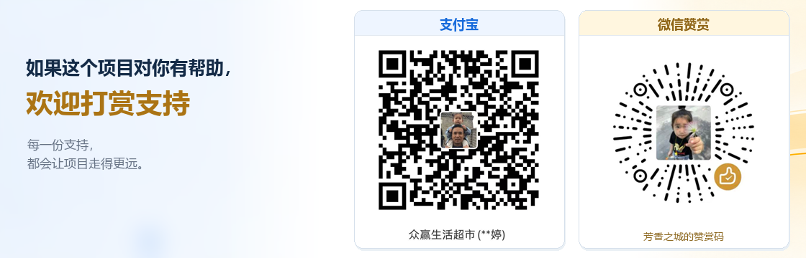

# B612-SDK

B612-SDK 的 Windows x64 二进制分发仓库。**目前仅公开构建产物，SDK 源码暂不提供。**

## 下载

| 构建产物 | 说明 |
| --- | --- |
| [Windows x64 二进制预览包](downloads/B612-SDK-0.1.0-preview-20261102-windows-x64-binary.zip) | SDK 0.1.0，C ABI v1，构建日期 2026-11-02 |
| [SHA-256 校验清单](downloads/SHA256SUMS.txt) | 下载后用于核验文件完整性 |

压缩包提供 `B612-SDK.dll`、MSVC 导入库、机器可读接口契约、构建信息和完整许可声明。OCR 模型与 ONNX Runtime 已内嵌，无需另行下载。需要 Windows x64、64 位调用进程及 Microsoft Visual C++ x64 运行库。

这是二进制预览包，不包含实现源码、语言绑定、范例、构建脚本或调试符号。下载并解压后，请先阅读包内 README 和构建信息；接入时通过 `sdk.info`、`sdk.capabilities` 确认实际接口。

## 使用与反馈

SDK 提供本机微信数据访问与桌面操作能力，需由使用者明确选择账号、查询范围、收件人与发送内容。首次发送需要完成窗口校准；实际兼容性仍取决于微信版本与桌面环境。

问题与建议请提交 [Issue](https://github.com/zhuyifang/B612-SDK/issues)。安全问题请使用 [GitHub 私密漏洞报告](https://github.com/zhuyifang/B612-SDK/security/advisories/new)，不要公开上传密钥、聊天、数据库或校准资料。

## 许可

[许可证原文](LICENSE)与第三方许可随二进制保留。源码公开范围的调整不改变已经授予的许可；再分发时请保留版权和许可声明。

## 支持项目

如果 B612-SDK 对你有帮助，欢迎自愿打赏，支持项目的持续维护。感谢每一份支持。

  

## 微信交流群

欢迎加入 **B612 星球助手**，交流使用经验、接入方案和项目建议。

  

当前群二维码标注 **11 月 9 日前有效**。点击图片可查看大图；若已失效，可通过 Issue 提醒更新。
